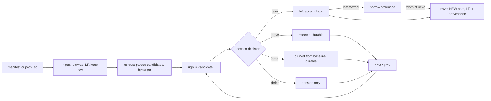

# 00034 — A baseline built from many machines

> Status: **approved 2026-10-14**. Supersedes nothing.
>
> Draft 1's spine was wrong in three places and was replaced rather than patched; §9 records what
> changed and why, because the corrections are more useful than the result. Draft 2's decision 15 was
> then wrong three further ways and became 15 and 15b — found by **measuring** it against the real
> corpus, never by re-reading it, which is §9's lesson arriving a second time.

A tool for the merge Brian does by hand: many machines each carry a `CLAUDE.md` and an `AGENTS.md`,
rules land on them independently, and periodically the best of all of them has to become one new
baseline that is pushed back out.

## 1. What this actually is

⛔ **Not a diff.** An **N-way consolidation with a mutable accumulator**, and the difference is the
design:

- The **left pane is an accumulator**, not a source. It is seeded, edited and pruned.
- Every take **invalidates earlier reviews**: once a section arrives from machine 3, the diff against
  machine 2 is not the diff that was reviewed, and A-then-B ≠ B-then-A.
- There is **no common ancestor**, so nothing can be auto-resolved.

The product is the **decision log**. The diff is the input.

## 2. What was measured, before deciding

Two real files, on 2026-10-14. This section exists because draft 1 deferred its riskiest assumption
to "judge it after using the tool", and the assumption turned out to be false.

| | JANUSSER6 | JanusHalo |
|---|---|---|
| bytes | 22,516 | 18,196 |
| lines | 419 | 232 |
| line endings | **418 CRLF**, 0 lone LF | **0 CRLF** — pure LF |
| headings, `^#{1,6}` scan | 19 | **0** |
| headings, **Markdig** | 19 | **18** |
| structure | plain headings | ⛔ **the whole document nested in one list item**, every line indented two spaces |

Three findings, each of which changed a decision:

- ⛔ **A line diff over these two files is almost pure noise.** Only **108 of 419** lines appear
  anywhere in the other, almost entirely because of that two-space indent. The review surface *is* the
  diff, so this is disqualifying without normalization — and it is not the reorganization risk draft 1
  predicted.
- ⛔ **A hand-rolled `^#` scanner finds 0 of 18 headings in one of two real files.** Markdig finds
  them through the list nesting. Decision 3 is load-bearing, and now on evidence rather than argument.
- ⛔ **A body hash over raw text cannot match across these machines.** Measured: the same text hashed
  raw and line-ending-normalised differs. CRLF against LF, plus two spaces of indent per line, means
  identical rules hash differently — breaking identity for exactly the cross-platform case the whole
  task is about.

### Where the corpus actually is

A tailnet sweep on 2026-10-14 found the N-way population is **not** where the request's framing
suggests — and a wider local scan the same day found it **4.5× larger** than the first count said:

| Corpus | Size |
|---|---|
| Global, cross-machine (`~/.claude/`) | **2** `CLAUDE.md`, **0** `AGENTS.md`, across 4 machines readable |
| Project, cross-repo (`C:\c\cl` alone) | **14** `AGENTS.md`, every one over 5KB — ClaudeForge 167KB, OpenForge2k 167KB, DiffView 124KB, XamlQuality 80KB — plus ~7 substantive `CLAUDE.md` |
| Project, **the whole of `C:\c`** | **63 over 5KB** — **42** `AGENTS.md` and **21** `CLAUDE.md` — out of **246** instruction files once copies are excluded. Largest: `cl/win11-identity-repair/CLAUDE.md` at **243 KB**, twice this repository's own |

⭐ **So N is 63 on one machine with no network involved**, against 2 global files estate-wide: decision
14's claim that the project corpus is where N actually is does not rest on the unreachable machines at
all, and a wider census would have to lift the global count past 42 to disturb it. ⚠ Of the 42
`AGENTS.md`, only **3** sit at a repository root and **24** are nested two or more levels deep — so
decision 12's partitioning of root scope from project scope carries real weight rather than being a
hypothetical.

⛔ **And 18 of the 264 raw matches are copies of documents already in the corpus** — worktrees,
vendored `reference/` trees and `bundles/`. `166667` bytes appears four times and `75546` three times,
and the three ClaudeForge `AGENTS.md` copies measure **166,795 / 166,668 / 166,667**: one document
drifting, not one document repeated, so **three hashes for one rule set, which no content-equality
rule can collapse.** Decision 15 is what this produced.
⭐ **And the size of the corpus is set by the exclusions, not by the disk — measured on `C:\c\cl`
with no depth limit:**

| What is excluded | Candidates |
|---|---|
| Nothing but the tier-2 copy directories | **684** |
| ⛔ Decision 15's first closed list of three, which omitted `artifacts/` | **684** — it admitted all **448** files under `Bennewitz.Ninja.XamlQuality/artifacts/mutate`, the mutation harnesses' working repo copies |
| Build and tool output, `artifacts/` included | **236** |
| …less the `@AGENTS.md` pointer, which is **90** of those 236 and **314** of the 684 | **146** |
| …substantive only, 5 KB and over | **56** |

So a figure for N means nothing without the exclusion rule beside it, and the first rule written was
wrong by a factor of nearly three on the first corpus it met. Decisions 15 and 15b are what this
produced; §7 carries what is still accepted as a risk.

A `CLAUDE.md` of 11 bytes is `@AGENTS.md`: the convention is a pointer, and `AGENTS.md` carries the
content. ⚠ **Coverage of the cross-machine half is still partial** — see §8 — but what it could change
is now bounded: two machines refused SSH with `Corrupted MAC on input`, one had no key, and
`brianb-2025` and the offline machines were not probed.

Also observed: januswax2 has a `.claude` directory and **no `CLAUDE.md`**, so a missing candidate is
ordinary, not exceptional. And the heading paths are **editorial sentences**
(`Working preferences > Instruction and config files change only with my approval of the exact text`),
which makes rewording a live risk rather than a remote one — see §8.

## 3. Decisions

Chosen from costed options on 2026-10-14, after an adversarial review replaced three of draft 1's.

| | Decision | Why, and what it rules out |
|---|---|---|
| 1 | **An app at `src/AgentBaseline`. Extracting a control is a named phase, triggered by one completed real merge** | Draft 1 claimed an app was cheap because it touched no library control; two gates read **`src`**, not the library, so that was wrong — see decision 13 for the real cost. With costs measured the app is still cheaper than the view checklist, and the deciding argument is not cost: **positioning content by markdown heading is knowledge about these files, not about diffing.** Rejected: a control now, which puts markdown structure inside a diff library and pays six artifacts before the interaction is proven; `tools/` outside `src`, which sidesteps the accessibility gates — defensible, and declined in favour of being gated like the demo |
| 2 | **A corpus of parsed candidates, not a path queue** | The coverage matrix (§10) needs every candidate parsed at once, and parsing buys the heading outline, per-candidate change counts before opening one, and divergence ordering. Rejected: load-one-discard-one |
| 3 | **Markdig in the app, as a locator only** | Headings, levels and line ranges from Markdig; **text from our own line array** — `Bennewitz.Ninja.FileServer` records that *"Markdig keeps a fenced block as slices over the original document rather than as a string"*, and we already hold the file. ⭐ Measured: a hand-rolled scanner finds **0 of 18** headings in JanusHalo's file. Rejected: a hand-rolled scanner, now on evidence; Markdig in `DiffView.Core`, which would make it a dependency of a published package and meet the nuspec gate, `BNAQ1003` and the trim check |
| 4 | **This repo now; ClaudeForge the likely eventual home** | ClaudeForge owns the file-model layer for these files and will host DiffView, but DiffView is unpublished (item 3), so consuming it there needs a cross-repo reference or the local-feed hand-off item 10 exists to complain about. An app project relocates cheaply |
| 5 | **Section-shaped decisions; a take is an edit of `LeftDocument` positioned by the LEFT's own parse** | ⛔ Draft 1 said a take was `CopyToLeft`, and that is a **destructive aligned replace**: `AlignedLinesOf`'s own summary reads *"the run a copy of that range replaces"* and `CopyLines` ends in `to.Replace(offset, length, text)`. Taking a section the diff happened to align against a different left section **deletes that section**. The accumulator is edited directly instead — `LeftDocument` is public and live — so how the right is laid out cannot move anything on the left. Rejected: `CopyToLeft`; a public selection API, which would regenerate `fixtures/api/sidebyside.txt` and contradict decision 1 |
| 6 | **Identity is heading path + a body hash over NORMALISED text. The durable store stays, but after the loop is proven** | The heading path identifies the *rule*, the hash its *version*; both are taken after decision 8's normalisation, without which neither matches across platforms (§2). The review objected that the same logic deferring a control defers a ledger — answered by **ordering**, not by dropping it: the end-to-end step comes first (step 7), so nothing is built on an unproven loop. Rejected: session-only decisions, which means re-rejecting the same rules every month, on a periodic audit where that run is where value appears |
| 7 | **A bare path list or `file://` URIs; a manifest is the richer optional form. Transport behind an interface** | The request said *"`file://` and/or other path list"*, so a path list is the **requested** input and is accepted with labels defaulted from the path; the manifest adds labels, targets and order. ⚠ **A path list can only express one target**: the filename distinguishes `CLAUDE.md` from `AGENTS.md`, but nothing in a path distinguishes a *root* file from a *project* one, so a corpus spanning scopes needs the manifest. Decision 12 is why that matters. Transport is excluded on measured grounds: `\\januswax2\c$` is access denied under current credentials, SSH needed a key *and* a different account name, and the estate spans Windows, Linux, Android and a QNAP. Rejected: a manifest as the only input, which was draft 1 answering a question about queue specification with evidence about byte transport |
| 8 | **Normalise on ingest; keep the raw bytes** | Unwrap a document wholly nested in a list item, normalise line endings, then parse — so the diff compares like with like and a take carries no stray indent. Raw bytes are kept for provenance and for reporting what the source really was. The detection is **structural**, from the parse tree, not a heuristic. Rejected: normalising per-section at take time, which leaves the review surface noisy; detecting and refusing, which refuses half of the two real candidates that exist |
| 9 | **The baseline is written as LF, to a NEW path the operator chooses, by the app itself** | ⛔ Draft 1 leaned on `SideBySideDiffView.Save`, which writes `source.Path` — **overwriting the seed machine's live `CLAUDE.md`**, where the request asked for *"a new file"*; and for the usual seed that file is this machine's, which the global `CLAUDE.md` says is written only after approval of the exact text. The app writes its own output, so it emits one canonical convention for an artifact distributed to four platforms. ⚠ One-time cost: the first LF baseline landing on a Windows machine reads as a whole-file change once. The **library** keeps round-tripping what it was given; those are different jobs. Rejected: `Save`; matching the seed's convention, which never closes the mismatch class |
| 9b | **The seed is named, and is excluded from the queue** | The left starts as one candidate's text; which one is stated in the manifest or chosen at start-up, never implied by ordering. That candidate is then **not** reviewed — a file against itself has nothing to offer — and the provenance report names it as the seed rather than as a source of takes |
| 9c | **A take that is then edited records the source identity, an edited flag, the resulting text, and a hash of the source section **as decision 6 hashes it** — over normalised text — at take time** | *"Merging the best"* means blending two phrasings, which is hand-editing in the left pane; there is no merge verb and the accumulator being editable is the mechanism. The durable store must not then claim the baseline carries the source's version, so a take records the **source identity** and an **edited** flag — next month reads *"taken from janushalo and then edited"* rather than *"already taken"*. ⭐ **Settled 2026-10-14: it also stores the resulting text and the source section's hash at take time, taken over **normalised** text per decision 6.** Verifying an edit against its source needs three reference points — the source *then*, the result, and the source *now* — and only all three separate *"janushalo is unchanged, your edit stands"* from *"janushalo has rewritten this, re-review it"*, which is the question a later run actually asks. The hash is one field and one comparison once the text is stored. ⛔ The deciding argument is recoverability rather than cost: the edit happens in a pane and is gone when the session ends, so this cannot be added afterwards. Rejected: the flag alone, which is a choice not to have the information rather than to defer it; the text without the hash, which pays the larger store and the two-sided identity model and still cannot attribute a difference |
| 10 | **Four verbs — take, leave, **drop**, defer — over two stores** | ⛔ `drop` is in the request (*"I freshen up by **deleting**/adding/merging"*), first in its list, and draft 1 had no verb for it. Pruning an obsolete rule is the only operation that makes the new baseline *lose* something every machine had, so it is durable and appears in the provenance report. The **durable** store holds taken, rejected and dropped by identity; the **session** store holds position, deferred sections and staleness. `defer` is session state because rejections persist: spelling *not now* as a rejection would poison next month's run, and as *undecided* loses that it was examined. Rejected: `defer` as durable; dropping `defer`, which leaves *not now* no honest spelling |
| 11 | **Staleness is narrow, and warns on save rather than gating it** | ⛔ **Literal staleness is near-universal** — any take stales every earlier candidate — so a gate on it is a wall. Narrowed: a candidate is stale only where **it carries its own version of a section the left has since gained or changed**. Save lists them and asks; the provenance report records the choice. Rejected: blocking the save, because a tool that refuses what the operator understands better gets worked around; marking only, leaving the one failure that is both silent and distributed |
| 12 | **The corpus is partitioned by target** | A `CLAUDE.md` baseline and an `AGENTS.md` baseline are different documents — this repository is the proof — and a root file and a project file are not candidates for the same baseline either. The request names all three scopes. A candidate declares what it is a candidate **for**, and a mixed set is refused rather than merged. Rejected: homogeneous candidates with only a label, which would silently merge working preferences into cross-file contracts |
| 13 | **No synthetic driver; nothing under `scripts/` is touched — but the `src` gates are paid** | `scripts/drive-demo` judges the **library's** rendering on three platforms, which the demo serves; a second app adds no platform, and every step below is headless. ⛔ What draft 1 missed: `AccessibilityCoverageTests` and `GridSlotTests` both scan `RepoPaths.Source("src")`, and the accessibility failure message anticipates this plan — *"a **THIRD markup-bearing project has appeared under src** — which then needs its own subject and its own floor, exactly as the demo has"*. So the app pays a third subject, a measured floor, `AutomationProperties.Name` on every interactive control, `BNXQ1004` grid compliance, and — because `AccessibilityCoverageTests.cs` **is** `A11yGate` — a full `mutate-gates` run. `LogPaths` and `DebugFlags` are demo-local, so there is no conflict there; draft 1 overstated that as a risk |
| 14 | **Scope-agnostic, but tuned and tested against the PROJECT corpus** | Decision 12 already makes a corpus a set of candidates for one target, so global and project scope are the same tool on different inputs — and the measurement above says the project corpus is where N actually is. Phase 1's fixtures and its first real merge use project `AGENTS.md` files, which **also removes transport from phase 1 entirely**: they are all local, so decision 7's interface stays a seam with nothing behind it to get wrong. ⚠ The cross-machine case is therefore the same tool on a different corpus, **not a later feature** — and it is the one the request literally described, so it must keep working. Rejected: global-only, which at N=2 makes divergence ordering, per-candidate counts and the matrix dead weight and brings unreachable machines onto the critical path; deferring the N-way features, which at N=14 large candidates means opening each blind to learn whether it is worth reviewing |
| 15 | **Two path tiers, pruned during traversal: build and tool output is never descended; a directory holding a COPY of ours is walked, judged and named** | ⭐ Settled 2026-10-14 and **corrected twice the same day by measurement**, which is the useful part of it. The first wording was one list of six names skipped after the walk had found them — wrong in kind, and pathological in cost. ⛔ **Wrong in kind:** `node_modules/`, `bin/`, `obj/` and `artifacts/` hold *other people's files and our own build and tool output* — a `CLAUDE.md` under `node_modules` is a dependency's and never a candidate — whereas `worktrees/`, `reference/` and `bundles/` hold *copies of our own documents*, candidates that happen to be duplicates. One list gives them one treatment, so hundreds of output files bury the handful of real copies in one report, and `include` offers to re-admit a file nobody would ever want. ⛔ **Pathological in cost:** skip-after-you-find-it is O(the disk), not O(the corpus). A scratch script written from the first wording walked every `node_modules` under `C:\c` and burned **1,174 s of CPU without printing a line**; the first repair then *reintroduced* it, by keeping all six names walkable so the files inside them could be judged. An implementer reading that wording writes the slow one — it happened twice here, inside an hour. ⛔ **And the closed list was already wrong on the first corpus tested:** `artifacts/` holds the mutation harnesses' working repo copies, **448 of the 684 files** the first wording would have admitted under `C:\c\cl`. So tier 1 is stated as a **class — build and tool output — carrying this estate's measured names** (`node_modules`, `bin`, `obj`, `artifacts`, `.git` and their kind): pruned during traversal, never descended, **reported as a count**, no manifest override, because nothing in it is ours. **Tier 2** — `worktrees`, `reference`, `bundles` — is walked, each file judged by **15b**, **named individually in the report**, and re-admittable by a manifest `include`. ⭐ **An explicitly named path is always a candidate**: pruning governs the *traversal* of a directory or a glob, never a path the operator wrote down. Rejected: one flat list, now on measured grounds; content-hash dedupe alone, for 15b's reason; operator curation, which spends the reviewer's attention on copies of documents they have already taken from |
| 15b | **A pointer file is not a candidate; and a tier-2 drop is judged safe by DOCUMENT IDENTITY, never by body hash** | ⭐ Both of these were found by measuring decision 15 rather than re-reading it. **A pointer is excluded by content, not by path** — a third kind of exclusion, which one list of directory names had no room for. §2 records that an 11-byte `CLAUDE.md` is `@AGENTS.md`; measured under `C:\c\cl` that single file is **90 of 236** candidates with output pruned and **314 of 684** without, 46% either way. It has no sections, so it can be neither taken from nor merged: it is reported as a count, like tier 1. ⛔ **It is also why content-hash dedupe is not merely weak but wrong** — 314 identical pointers collapse into one entry, taking with them the fact that 314 distinct repositories are in the corpus at all. **And the drop-safety test is identity, not bytes.** Measured: **32 of 66** tier-2 drops under `C:\c\cl` matched no kept file by normalised hash, which reads as *"the rule loses 32 unique documents"* — and every one is an **older version of a document we hold current**: pinned `reference/ClaudeForge/AGENTS.md` at 75,546 and 74,909 bytes against the live 166,668, three `worktrees` copies at 166,667 against 166,795. Dropping those is exactly right, so the hash was the wrong question, asked by this plan's own first attempt at the test. Decision 6 already draws the line — a heading path identifies the *rule*, its hash the *version* — and the same split holds one level up: **a path identifies the document, a hash identifies which version of it**. A tier-2 file is safely dropped when some kept file shares its document identity, whatever version either is |

### Deliberately not decided

**How a transport provider is loaded**, when one exists. At the call site both candidates are *give me
the text for this candidate*, so the interface admits either.

| Mechanism | Cost |
|---|---|
| `AssemblyLoadContext` plugin | A collectible context unloads only when **nothing** holds a reference; leaks are easy and miserable to diagnose. Dynamic loading fights trimming, and `Trim Check (Release linux-x64)` is a required check. The contract wants a published abstractions package, which DiffView cannot provide yet — the estate's shape is `Bennewitz.Ninja.AppServices.Abstractions` |
| Out-of-process command | The tool invokes a command that prints the file. Same isolation, any language, no contract assembly, no unload semantics, no trim interaction. The transport *is* `ssh`/`scp` work |

## 4. Scope

**In.** A corpus from a path list or manifest, partitioned by target, normalised on ingest and parsed
for headings. A left accumulator seeded from one candidate, editable, survived across cycling. Next,
previous and jump. Section-granular take, leave, drop and defer. A durable store of taken, rejected
and dropped; a session store of position, deferred and staleness. Narrow staleness, warned at save.
Save to a new path as LF, with a provenance report.

**Out, explicitly.**

- Any transport — no SSH, no SMB, no tailnet awareness (decision 7).
- Any library control, theme, peer or `fixtures/api` change (decision 1).
- Any change to `DiffView.Core` or the diff model (decisions 3, 5).
- Any change under `scripts/` (decision 13).
- Distribution. The tool writes a file; pushing it to machines is a script's job.
- Front-matter *fields*. These files carry none; ClaudeForge's round-tripper becomes necessary only if
  this extends to memory or skill files, which do. Front matter is still **detected** so it is never
  mistaken for a setext heading.
- Auto-merge. There is no base to resolve against.

## 5. What the control gives us, verified

| Needed | Already true |
|---|---|
| The left survives cycling the right | `DiffBuildController.OnSourceChanged` is strictly per-side; assigning `RightSource` leaves the left's text, edits, undo stack and dirty state untouched |
| An editable left, read-only right | `LeftReadOnly` / `RightReadOnly`, wired on both the template and property-change paths |
| A live, writable accumulator | `LeftDocument` is public and live — AGENTS.md §6 warns of a viewer "made writable in one line", which is the property this tool depends on |
| Hide what matches | `UnchangedContextRows` — *Show All*, *Show Differences*, *Show Context* |
| Writing bytes | `PaneWriter.Write(path, text, encoding, lineEnding)` is in the model layer, so the app writes its own output without `Save` |

⚠ **Two rows draft 1 had here were wrong.** `CopyToLeft` is destructive (decision 5) and `Save`
overwrites the source (decision 9); neither is "already true" for this tool. And per-candidate change
counts are **not** free — the control computes one pair, so the app runs N−1 diffs itself through the
public `DiffDocumentBuilder.Build`.

## 6. Steps

Numbers in verifications are measured and written down at the time, never carried from this document.

⭐ **The plan is done when one real consolidation has been completed with the tool across Brian's own
machines and the resulting baseline distributed** — not when step 12 lands. Every step below verifies a
part; only that verifies the thing. It is also the trigger decision 1 names for reopening the control
question, so the two are the same event.

| # | Step | Verification |
|---|---|---|
| 1 | `src/AgentBaseline`, in `DiffView.slnx`, `IsPackable=false` | ⛔ Not "it launches": `dotnet build DiffView.slnx` and `dotnet test --solution DiffView.slnx` both pass, and the suite total has risen by this project's tests. A project absent from the solution is built on no runner, and draft 1's verification would have passed in that state |
| 2 | The parse: Markdig as locator, one line-base boundary | Fixtures with **expected heading sets**, not merely fixture shapes: a `#` at column 0 inside a fence, `~~~` fences, YAML front matter, setext, `## Closing ##`, `#NoSpace`, and ⭐ **a copy of JanusHalo's real shape** — a document wholly nested in a list item, which must yield its headings and not zero. ⛔ `HeadingBlock.Lines` is empty; the text is in `Inline`. `Line` is **0-based** and AvaloniaEdit is 1-based: the conversion lives in exactly one place, as `PaneMetadata` does |
| 3 | Ingest normalisation | A round trip over the JanusHalo shape: unwrap, normalise, and assert the normalised text's headings equal the plain file's **and** that the raw bytes are retained unchanged. A normalisation that corrupts silently is the risk, so the assertion is on content, not on "it ran" |
| 4 | The corpus: labels, targets, counts, order, **and all three exclusions** | A fixture set asserting labels, per-candidate change counts, divergence order; that a **missing** candidate is reported rather than skipped (measured: januswax2 has none); and that a **mixed-target** set is refused. ⭐ Decisions 15 and 15b need **four** assertions where draft 2 had one. **Tier 2:** a tree whose `worktrees/`, `reference/` and `bundles/` hold copies queues none of them and **names each in the report**, a manifest `include` re-admitting one — and ⛔ the fixture's copies are **older versions, not byte-identical ones**, because that is the case the first test got wrong and it is the common one. **Tier 1:** a tree carrying `node_modules/`, `bin/`, `obj/` and `artifacts/` reports a **count** and ⛔ **never descends — asserted by instrumenting the traversal, because "no candidate came out" passes for a walk that visited everything first**, which is exactly how the cost defect survived its own repair. **Pointers:** a tree of `@AGENTS.md` files yields no candidates and a count, and ⛔ **does not collapse to one**, which is what a content-hash rule would do to 314 distinct repositories. **And** a path the operator **names explicitly** under a pruned directory is still a candidate |
| 5 | Cycling with the accumulator intact | Edit the left, cycle the right twice, assert the left's text **and** that an undo still reverses the edit. ⛔ The build is async — AGENTS.md §5: *"A build is awaited, never pumped for"* — so this needs a host with a hand-advanced clock; `CompositeHost` is internal to the library's test assembly, so this project writes its own |
| 6 | take, leave, drop, defer — and the **session store** they write to | ⭐ The **negative** is the point: over a fixture whose candidate is reordered so the diff misaligns, take a section and assert **every other left section is byte-identical afterwards**. A "the left gained these lines" assertion passes while the left silently loses a rule, which is exactly what draft 1's step 5 would have done. Plus: `drop` removes a section; `leave` and `defer` are distinguishable, one durable and one session |
| 7 | ⭐ **The loop, end to end** | The one thing the request describes by its UI affordance and draft 1 never checked: over three candidates, seed, take a section, **cycle with the next command**, take another, drop one, save — then assert the saved bytes and the provenance report. Before the stores are built, so a wrong loop is found before a ledger sits on it |
| 8 | The two stores across a restart | Record decisions, dispose, reload, find them — keyed so a **reworded** version of a rejected section is presented again while an identical one is not. ⛔ And that a **deferred** section is *not* in the durable store: the poisoning decision 10 exists to prevent must be provable. ⭐ Then decision 9c's three points across that restart: an edited take reloads carrying its **resulting text** and the **source hash as decision 6 computes it** — over normalised text, so it survives a CRLF/LF or list-indent difference (§2), and the two cases are told apart — source unchanged since the take reads *"your edit stands"*, source moved reads *"re-review"*. A test that reloads only the flag passes while the store holds neither |
| 9 | Narrow staleness | ⛔ Positive **and** negative: taking a section a candidate has no version of must leave it unstale; taking one it carries a differing version of must mark it. A positive-only test passes on literal staleness, which decision 11 rejects as a wall |
| 10 | Save | Output is at a **new** path, **LF**, and ⛔ **the seed candidate's bytes are unchanged afterwards**. Saving with a stale candidate surfaces it and proceeds only on acknowledgement. The report names each taken section's source label, each rejection, each **drop**, and any staleness accepted — and, per decision 9c, marks an **edited** take as edited rather than as taken, which is the one line of the report that can be a quiet lie |
| 11 | The `src` gates | A third subject and a measured floor in `AccessibilityCoverageTests`; `AutomationProperties.Name` on every interactive control; `BNXQ1004` clean. ⛔ Then a **full `mutate-gates` run**, all mutations behaving as declared — owed because a gate file moved, and CI never makes one |
| 12 | The record | `AGENTS.md`, `DECISIONS.md`, `CHANGELOG.md`, `PROGRESS.md`, and `README.md`'s project table, which lists the three `src` projects and would otherwise go stale |

## 7. Risks

- ⚠ **Heading paths are editorial sentences**, measured: `Working preferences > Instruction and config
  files change only with my approval of the exact text`. Rewording is therefore *likely*, not remote,
  and a reworded heading lapses identity: the rejection is forgotten, the coverage count splits one
  rule into two, and — compounding — **narrow staleness is blind to it**, because staleness is defined
  over the same heading path. A candidate whose version of a rule sits under a different heading is
  never marked stale and never re-reviewed. Normalising the heading for keying (case, punctuation,
  emphasis) narrows this; it does not close it.
- ⚠ **A moved section still displays as a delete plus an add.** Decision 5 makes it harmless — the take
  no longer depends on alignment — but the display still reads wrong, and these files are reorganised
  constantly. This is now a *legibility* cost rather than a data-loss one.
- ⚠ **Cross-candidate conflicts have no expression.** Two candidates carry variants of one section;
  take the first and the second shows as a difference forever. Identity makes it detectable; phase 1
  does not act on it.
- ⚠ **Ordering is load-bearing.** Staleness is the only defence, and step 9's negative assertion is
  what keeps the definition useful.
- ⚠ **A second app is a second thing to keep green on five CI legs**, including the `de-DE` culture leg.
  Any test asserting English text wants `[EnglishChrome]` on the method.
- ⚠ **Adding a Markdig pin touches `Directory.Packages.props`**, which AGENTS.md §5 names as "a pin" —
  so a full mutation run may be owed for that alone, independent of step 11. Confirm against the rule
  rather than assuming it cancels.
- ⛔ **Decision 15's tier 2 loses real documents, and this is measured rather than feared.** Under
  `C:\c\cl`, 66 files fall to it and **32 match no kept file byte for byte** — all of them older
  versions of documents we hold current, which 15b is why that is correct. But the residual stands: a
  project whose *only* instruction file sits under a directory named `reference/` is excluded, and
  **naming every tier-2 skip in the report** is the whole defence. The manifest `include` is the
  escape hatch, and nothing detects that it was needed.
- ⛔ **Tier 1's risk is the same shape and the two are NOT symmetrical.** It reports a count, so a
  genuine candidate wrongly sitting under `bin/` or `artifacts/` is invisible rather than merely
  skipped. Accepted deliberately — the alternative is naming every dependency's and every mutation
  worktree's instruction file, 448 of them on this corpus, which is the noise tier 1 exists to
  remove. An explicitly named path still wins, and it is the only route back.
- ⚠ **Tier 1 is a class with an open membership, so it will be wrong again.** `artifacts/` was missing
  from the first closed list of three and accounted for 448 of 684 files on the first corpus anyone
  tested it against. The next estate will have a name this one does not.
- ⚠ **Decision 9c puts document content in the durable store**, which draft 2 had holding identities
  alone. It grows with the baseline and it holds the operator's own phrasings rather than a machine's,
  so it is content at rest. Nothing here logs it or sends it anywhere, and the app writes only where
  the operator points it — but the store has stopped being a ledger.

## 8. Deferred, and what each waits for

| Deferred | Waits for |
|---|---|
| **A reusable control** | One completed real merge. Decision 1 makes this a named phase with a trigger, not an open question |
| **The coverage matrix** | The editing surface proving itself. Decision 2 keeps it a read over existing data |
| **Section-aware alignment** in the diff model | Evidence from use that fragmented display is the real cost (§7) |
| **Acting on cross-candidate conflicts** | A real merge showing how often two machines carry genuinely different variants |
| **A transport provider** | Nothing technical; the mechanism fork is costed in §3 |
| **Front-matter fields** | Extending to memory or skill files. ClaudeForge's `YamlFrontMatter` has `Parse` **and** `Compose`, deliberately a small YAML subset because *"a full YAML library would bring implicit type coercion and node re-ordering that a round-tripping editor must not have"* |
| **A full census of the cross-machine corpus** | ⚠ **Narrowed on 2026-10-14** by the wider local scan §2 now carries: the **sizing** half is discharged, N being 63 over 5KB on this machine alone against 2 global files estate-wide, so decision 14 does not rest on the unreachable machines. What is still owed is the cross-machine global count — and, **separately from this plan**, why `homeassistant` and `janusqnap473a` both refuse SSH with `Corrupted MAC on input`, a transport-level failure worth its own look. `janustour5g` had no key, `brianb-2025` was not probed (Windows, different path and shell), and `janussurfacepro` and the two Android machines were offline |
| **The move to ClaudeForge** | DiffView publishing (item 3) |

## 9. What the review changed

Draft 1 was reviewed adversarially the day it was written, by a reader given the original request and
not its framing. Three findings were spine-level, each confirmed by reading the code rather than
accepted on report:

| Draft 1 said | The code said |
|---|---|
| a misaligned take is "the risk most likely to make the tool **annoying** rather than broken" | `CopyLines` ends in `to.Replace(offset, length, text)` over the **aligned** range — a take deletes whatever the left holds there. Data loss, not display. Decision 5 |
| "Save the accumulator", leaning on `Save` | `Save` writes `source.Path`, **overwriting the seed machine's live file**, where the request asked for a new one. Decision 9 |
| an app is cheap because it "touches no library control" | `AccessibilityCoverageTests` and `GridSlotTests` scan **`src`**, not the library, and the former is a gate file. Decision 13 |

And three more came from measuring real files rather than reasoning: the line diff is noise without
normalisation, a hand-rolled scanner finds nothing in one of two files, and a raw body hash cannot
match across platforms (§2).

⭐ **The pattern worth keeping**: every one of those six was found by *reading the thing* — the code, or
two real files over SSH — and none by re-reading the plan. Draft 1 was internally consistent and wrong.
